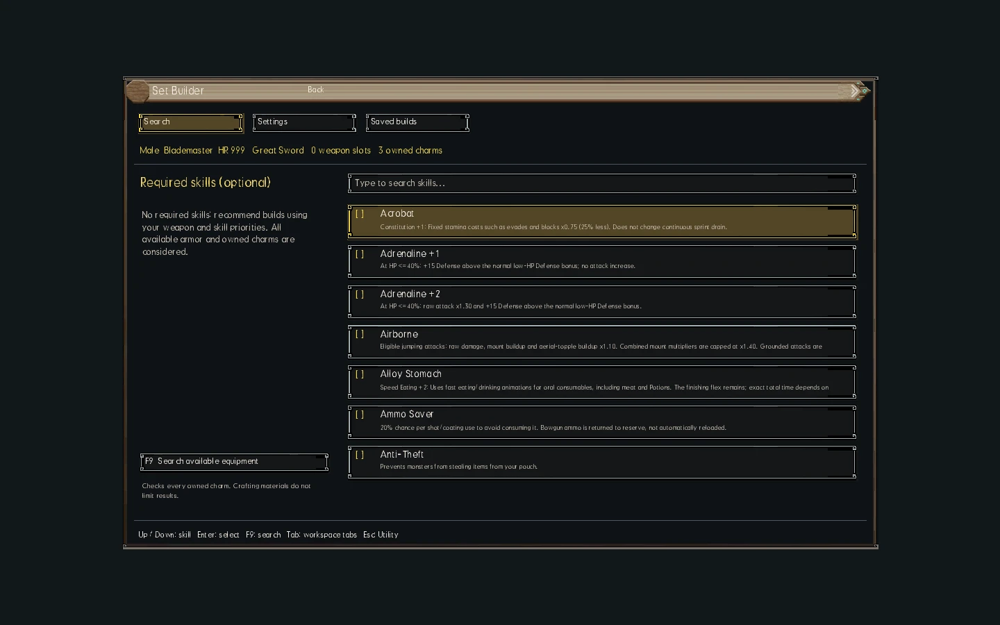
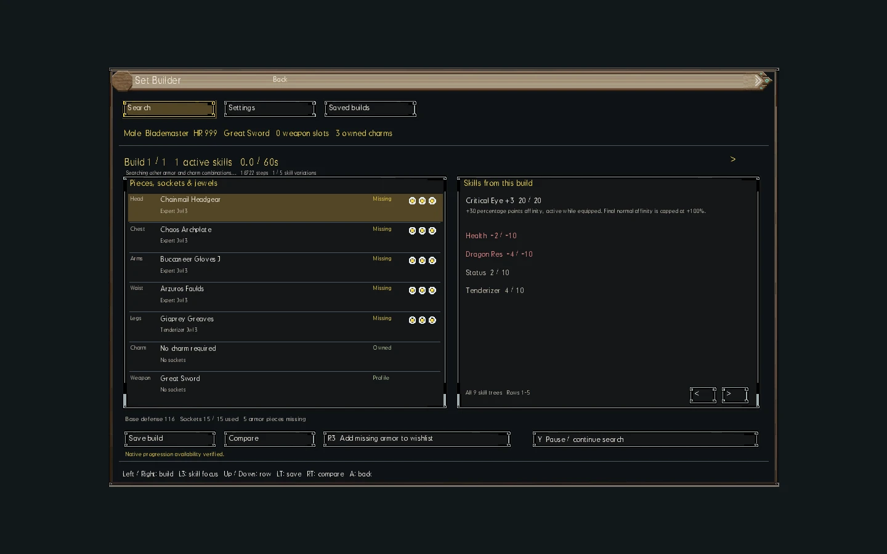
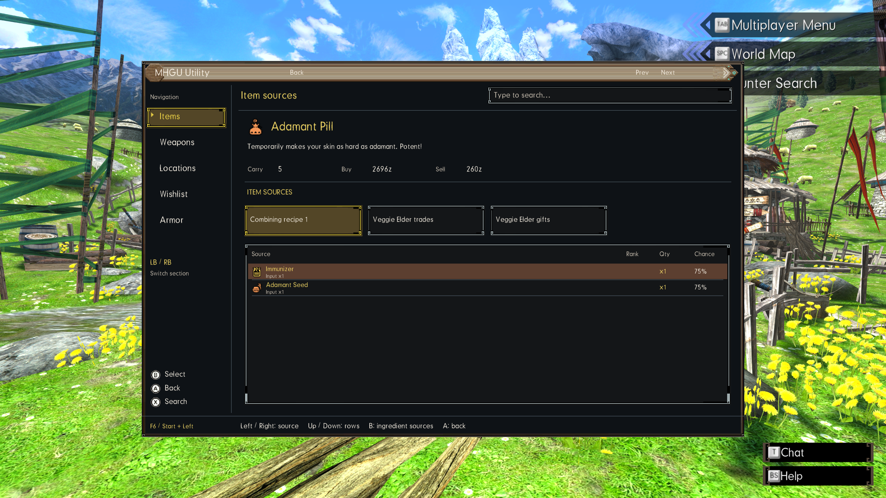
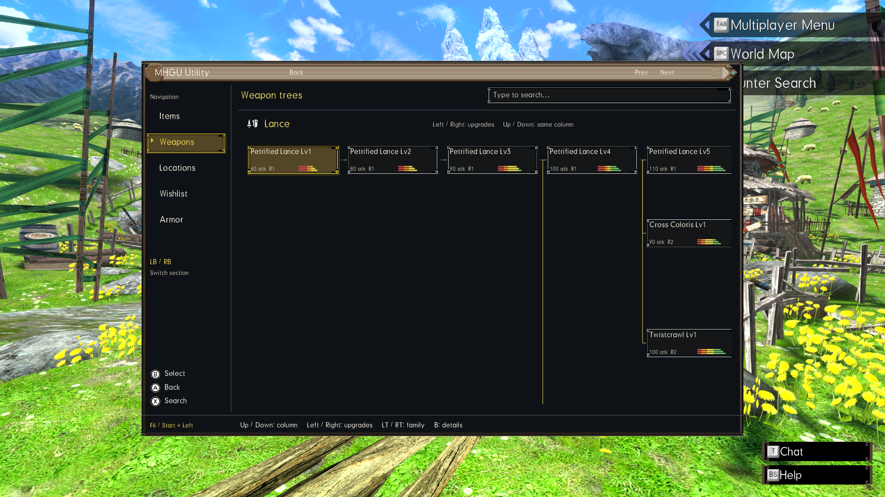
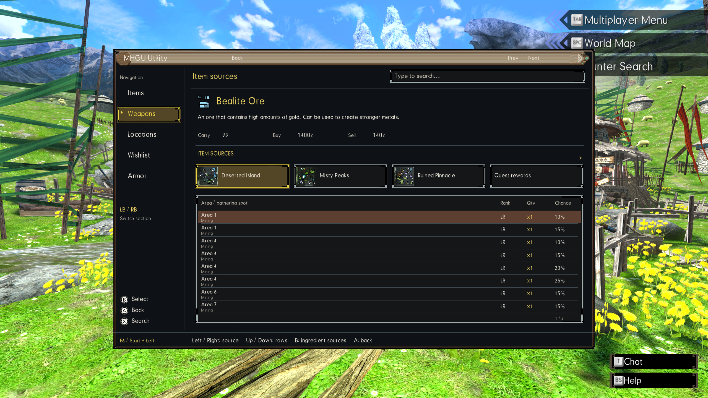
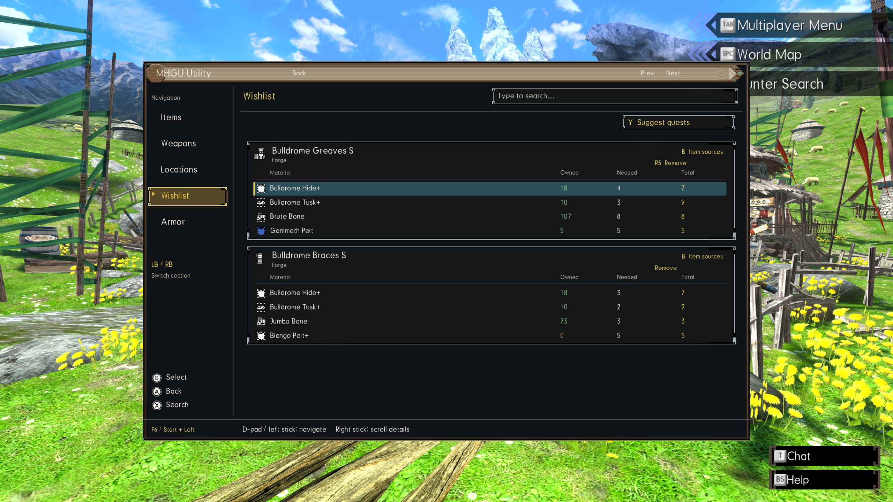
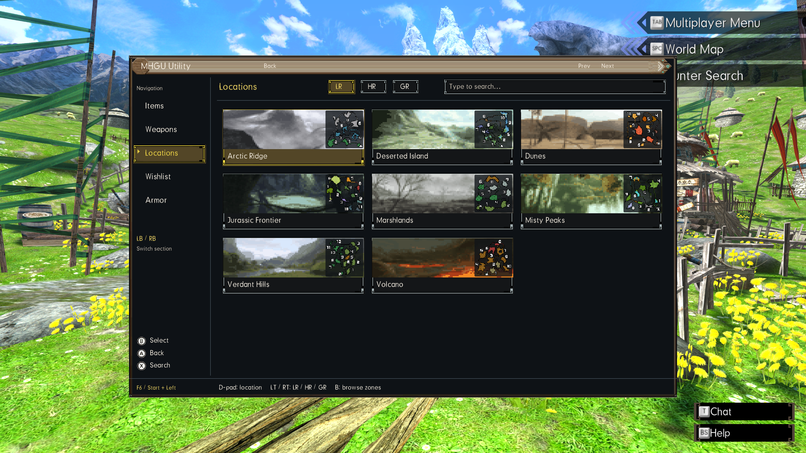
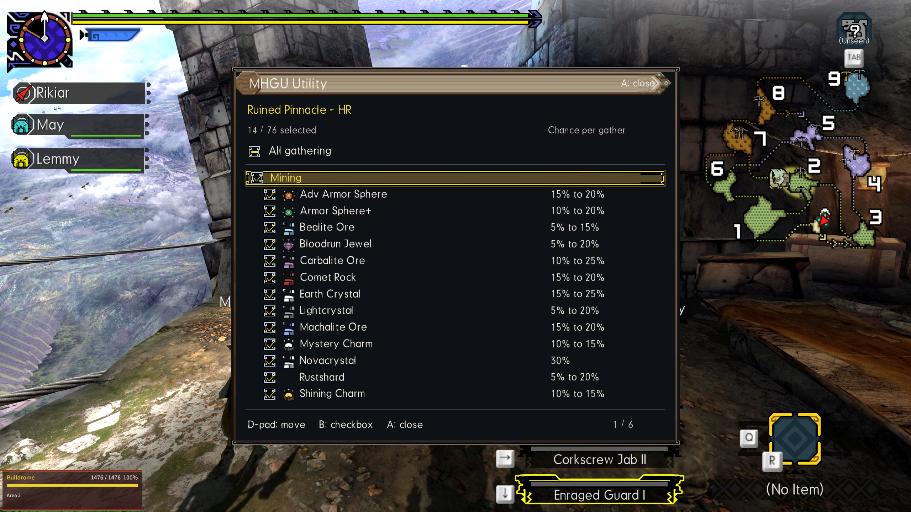

# MHGU Utility

A standalone Forge plugin for MHGURecomp 0.15.4 or later and MHGU 1.4.0. Browse items, weapon
upgrade trees, armor pieces and sets, crafting materials, gathering and monster
reward sources, and a persistent wishlist.
The game continues while the browser is open. Armor details include a native
full-set model preview using installed texture replacements. Right stick rotates
the preview; equipped armor and stats stay unchanged.

[Download the release](https://github.com/Rikiar73574/mhgu-utility/releases/latest)

[Build from source](docs/BUILD.md)

[Screenshots](docs/SCREENSHOTS.md)

## Features

- **Item browser:** searchable categories, item icons, descriptions, and acquisition
  sources grouped by map, monster or quest. Sources show rank, quantities, drop
  rates, and carve, capture or break conditions where available.
- **Weapon trees:** connected upgrade trees for each weapon type, rarity ordering,
  weapon stats, sharpness, crafting recipes, and clickable material sources.
- **Armor browser:** browse sets or individual pieces; filter by rank, hunter type
  and gender; distinguish Blademaster and Gunner entries; inspect defense, resistances, slots, skills and crafting materials.
- **Armor previews:** rotating native full-set models using the game's assets and
  installed texture replacements, where a reliable model mapping is available.
- **Weapon and armor wishlists:** save individual recipes or complete armor sets,
  inspect materials directly, and remove entries from the wishlist. Supported
  weapon-upgrade screens also provide an in-game wishlist shortcut.
- **Live material counts:** combine item-box and pouch stock, update shortages as
  items are gathered, and keep a compact passive wishlist tracker visible in hunts.
- **Quest planning:** suggest eligible unlocked quests covering wanted materials
  through gathering, monster drops and rewards. Prowler quests are excluded by
  default and can be enabled in settings.
- **Location browser:** map artwork and minimaps, a shared LR/HR/GR selector, and
  gathering items grouped by area and gathering type.
- **Gathering map filters:** native Start-menu entry, category and item checkboxes,
  drop-rate ranges, and matching gathering-point markers across the quest map.
  Grey and gold mining spots use distinct native pickaxe icons. Markers stay at
  their map positions and work alongside Map Assist.
- **Controller, mouse and keyboard:** MHGU-style frames and lettering, controller
  navigation, direct keyboard search, text editing and clipboard shortcuts, plus
  an optional on-screen controller keyboard and adjustable interface size.
- **Standalone operation:** no HuntLog backend, browser or external service is
  required during gameplay. Wishlist and settings persist in separate files.

### Set Builder

Select Set Builder in the sidebar, then press B / Enter (or click Open Set Builder)
to open its workspace with **Search**, **Settings** and **Saved builds**.
Back returns through its views to the general Utility browser. Each result shows
armor ownership, charm and weapon sockets, exact jewel placements, and every
contributing skill tree together, including inactive points and penalties.
Active skills include numerical effects and activation conditions.

Search uses the equipped weapon's class, element/status and sockets, all owned
charms, and native armor type, gender and unlock checks. Required skills are optional: leave the list empty to recommend builds using
your weapon and skill priorities. Selected skills are minimum tiers; stronger
tiers qualify. Missing crafting materials do not exclude
armor. Every result receives a bounded jewel-refinement pass, including sets that
already meet the requested skills. Empty sockets can remain when no beneficial
placement is found within the budget; results are best-found rather than exhaustive.

Settings has separate **Requirements** and **Skill Priorities** pages. Requirements
provides Village/Hub dropdowns with independent Automatic options, an owned-armor
checkbox and a weapon-socket override. Automatic uses your character's unlocks for
that quest group; explicit stars are planning overrides and do not prove recipe
or special-quest unlocks. Changes apply to the next search.

Skill Priorities uses numbered **Priority 1–4** slots. The original damage, weapon
support, comfort and utility groupings are defaults. The four priority slots stay fixed; open a list and
assign individual skills to a different priority. The standalone
**Reset Set Builder Settings** button restores defaults without removing saved builds.

Search processes bounded batches within a cooperative 1 ms scheduling window,
up to eight slices per frame. An individual slice can overrun that window.
It pauses at 60 seconds or five distinct positive skill combinations; Y resumes.
Save up to 12 named loadouts, rename/delete/reopen them, compare loadouts, or add
missing armor to the wishlist. Saved builds retain their original weapon sockets
and jewel placement; reopening checks compatibility and charm ownership, while a
fresh search revalidates current availability. Preferences and loadouts use
`utility_set_builder.txt`, separate from the character save. Mixed-set model
previews are not included yet.

| Optional required skills | Suggested builds |
| --- | --- |
|  |  |

[Workspace, settings and validation](docs/set-builder-v0.5.md). These screenshots
use the compiled ARM renderer with isolated fixtures, not a live hunt.

## Controls and details

Item sources include all monster drops and quest rewards available in the local
MHGenDatabase, with LR/HR/GR, carve/capture/break conditions, reward slots,
quantities and rates. Items can list both monster drops and quest rewards.
[Source coverage](docs/source-coverage.md) records 2,840 acquisition pages,
41 internal game entries and 25 explicit data gaps; sources are never guessed.

- Start + D-pad Left opens or closes MHGU Utility; F6 is the keyboard shortcut.
- During a quest, open **MHGU Utility** on page two of the native Start menu,
  or use Start + Left / F6, to filter gathering points. Category and individual
  item checkboxes list this quest map's drops and their chances. Ranges mean
  different spots have different odds; quantities do not multiply those odds.
  Nothing is selected initially. Close the checklist to keep playing with only
  matching spots marked across the whole map. Depleted or inactive points
  disappear. Map Assist keeps its own monster markers; these icons need no KatLib.
  The two mining-point types use grey and gold native pickaxe icons. Markers
  retain their actual native map positions, including overlaps. Player and
  monster markers do not reposition them.
- The dedicated **Set Builder** sidebar section searches for up to six requested activated skills using
  your character's gender, hunter type, equipped weapon slots and progression.
  It includes unowned armor without requiring crafting stock, and checks every
  owned charm. Requested skills are minimums, so higher tiers remain eligible.
  Focused seed searches explore bonus skill combinations before the broad search,
  so one family of similar builds cannot consume the entire search window.
  Spare slots are refined for bonus skills using available decorations, without
  breaking the requested skills. This bounded search does not guarantee the best
  possible combination. Choose skills with B, then Y to search or pause.
  L3 (F10 on keyboard) explains the highlighted skill in the picker and opens
  the skill column in build results. Active skills include numeric effect captions;
  B (Enter) on an active skill opens the full effect, with D-pad scrolling and
  A (Escape) to return. The summary shows bonus skills,
  penalties and inactive skill-point totals; slot icons and decoration placements
  show how armor, charm and weapon slots are used. Left/Right selects
  a build; Up/Down selects a piece or skill. R3 adds missing
  armor pieces to the wishlist. A goes back.
  Verified equipment is tried first. Results with incomplete acquisition-source coverage are explicitly marked
  **availability unverified**; these may include armor whose unlock cannot yet be confirmed. Unindexed acquisition paths are never treated as proof that armor is locked. The search keeps the best 24 builds found and continues improving their fit,
  using the selected skill priorities, then fit, jewel use and free capacity.
  It pauses after 60 seconds or five new active-skill combinations; Y continues
  from the same position. These are best-found results,
  not a claim of global optimality. Full mixed-set
  previews are not yet part of the builder.
- Xbox B selects; Xbox A goes back. LB/RB changes section. Game buttons and
  movement are blocked while the interactive utility is open, including when
  another Forge mod supplies controller state. Closing restores normal input;
  the passive HUD leaves gameplay controls available.
- MHGURecomp 0.15.4 or later keeps the mouse free while browsing. Clicking the
  Compendium does not capture it; Escape retains the game's mouse-release shortcut.
  The passive hunt tracker leaves mouse-look controls unchanged.
- X opens a compact QWERTY controller keyboard with live matches and clickable keys.
  Type directly on a physical keyboard to search inline, without opening that
  keyboard. Selection, caret movement, cut/copy/paste and UTF-8-safe deletion are
  supported; Up/Down immediately browses search results while Left/Right edits
  the caret. Hints follow the active device. Searches stay within the selected
  weapon type. Interface size can be
  adjusted in the Forge settings.
- Weapon families and sibling branches are ordered by rarity. LT/RT jumps between
  families; Up/Down stays in the same tree column.
- Armor can be browsed by set or equipment slot, with rank, hunter-type and gender filters. Y changes hunter type, L3 gender
  and LT/RT rank; keyboard equivalents are shown on screen. Its details show defense, resistances,
  skill points, crafting materials and the other pieces in the same set. Opening
  a set shows combined defense, resistances, slots and skill activations; the
  Full set / piece tabs switch between the overview and individual equipment.
  Models require a reliable mapping to the owned game dump; unmapped sets show
  an unavailable message. No models or textures are embedded in the plugin.
- R3 adds or removes a weapon or armor recipe from the wishlist, including supported
  native weapon-smithy upgrade screens. Y adds the complete armor set, preserving
  pieces already saved.
- In Wishlist, R3 removes the selected recipe; its Remove action also works with
  the mouse. Up/Down still selects materials, and removal is always manual.
- Forge settings has a persistent **Include Prowler quests** toggle, off by default.
  Changing it immediately refreshes an open quest route. Settings are stored in
  `compendium_settings.ini`, separately from the wishlist.
- In Wishlist, Y opens a suggested route through eligible unlocked quests. It
  combines gathering areas, stable monsters and quest rewards, using both the
  game's unlock and entry-condition checks. Downloaded event quests still need
  to meet their HR requirements. At equal material coverage, hunts targeting the needed monster rank above
  incidental encounters, before rank/star tie-breaks. Named material quantities use shared demand
  minus combined box/pouch stock. Material-point recipes use a shared whole-item stock allocation and show
  eligible alternatives. The suggested allocation is conservative; it does not
  calculate an optimal shortage or expected quest runs. Drop quantities are not guaranteed.
- Material rows open their acquisition sources. The wishlist reads box and
  physical pouch inventory and stores its own `compendium_wishlist.txt` file.

Utility v0.5.1 includes a compatibility guard for MapAssist `4c218`: native
companion markers are preserved instead of being mistaken for monsters. It
activates automatically when that supported MapAssist binary is present.
No additional plugin or updater change is needed.

Install one `hunters_compendium.nro` at
`romfs/nativeNX/plugins/hunters_compendium.nro` inside its mod folder, enable the
folder in Recomp, and restart. Keep the original game saves backed up.

This source includes the smithy hook compatibility change used with the
standalone Armor Fusion plugin. The earlier patched build passed both
load orders. This standalone build passed the complete installed mod stack on
Linux with stock MHGURecomp commit `a272b61`, using copied saves. See the
[validation records](docs/validation.md) and [UX validation](docs/ux-validation.md) for the exact historical artifact and coverage. Older Recomp versions share a
12 MiB plugin region; newer versions also provide a spill arena. Account for all
plugins, BSS and loader alignment. Utility's current individual budget is
9 MiB + 64 KiB; a budget pass does not establish whole-stack compatibility.
For Modern Weapon Trees and KatSmithy, see the separate
[smithy compatibility investigation](docs/smithy-compatibility.md): the deferred
smithy hook is ARM regression tested, while combined plugin capacity and live
coexistence still require validation.

See [build instructions](docs/BUILD.md), [source provenance](THIRD_PARTY_NOTICES.md),
and the research notes under `docs/`.

Game-derived metadata, minimaps, cached illustrations and weapon renders are
local build inputs. They are not included in this source repository. The
renderer and generation paths are retained; supplying the same local generated
modules preserves the existing full UI. No HuntLog plugin or backend is needed
at runtime or to compile this standalone tree.

## Screenshots

Actual in-game captures from 20 November 2026. Click an image for full size.
[Full gallery and capture details](docs/SCREENSHOTS.md).

| Item browser | Weapon tree |
| --- | --- |
|  |  |

| Material sources | Wishlist and live stock |
| --- | --- |
|  |  |

| Location browser | In-quest gathering filters |
| --- | --- |
|  |  |

## Naming acknowledgement

Ghostryx117’s MHGU Compendium is a separate project whose name predates this
project and inspired its former name. This project is now called MHGU Utility
to avoid confusion. See [the naming discussion](https://github.com/Rikiar73574/mhgu-utility/issues/4).

The existing plugin, archive and saved-data filenames remain unchanged for
compatibility with installed mods, wishlists and settings.
