# Screenshots

## Current interface

Captured on 20 November 2026 in an isolated test game with a copied save,
using the Windows executable under Wine on Linux. The main views are native
2560 × 1440 captures; the Set Builder preview captures are 1216 × 760.
HD textures, the Hunter Font and other installed mods are visible, so their
appearance can differ from a stock installation. These are actual game captures,
not mockups or the emulated preview renderer.

Images are encoded as lossless WebP. Decoded RGB pixels were checked against
the original PNG captures. [Capture dimensions and checksums](screenshots/current/captures.json).
Click any image to view it at its original resolution.

| Item categories | Item list |
| --- | --- |
| 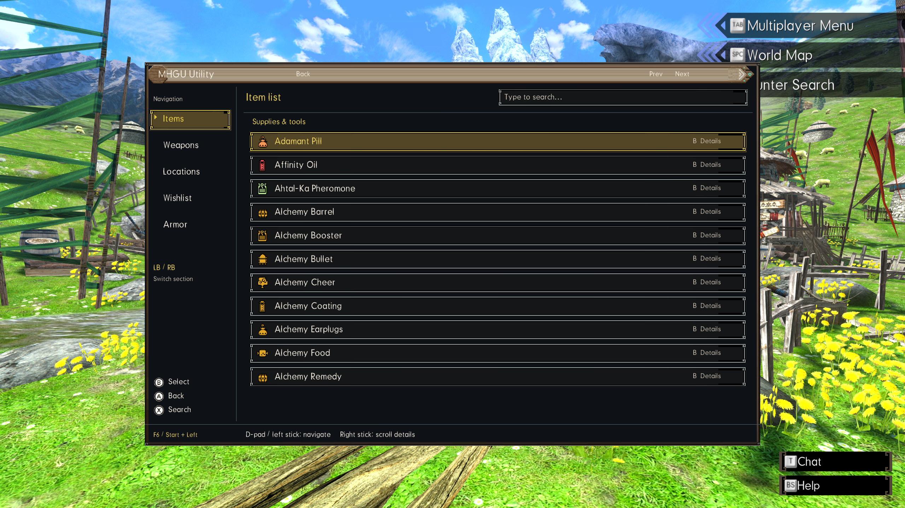 | 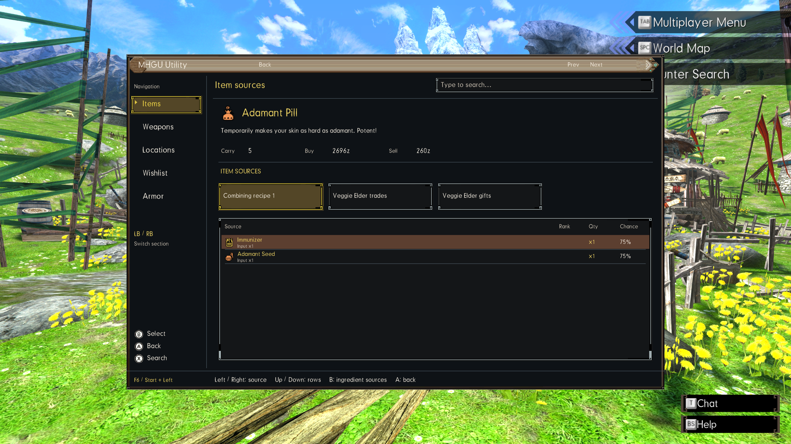 |

| Weapon tree | Weapon details |
| --- | --- |
| 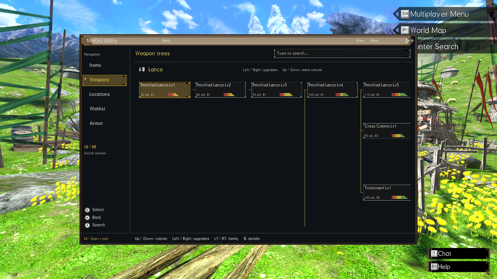 | 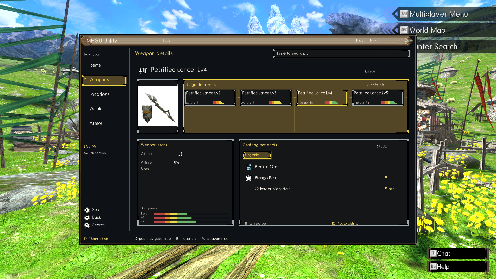 |

| Material sources | Wishlist |
| --- | --- |
| 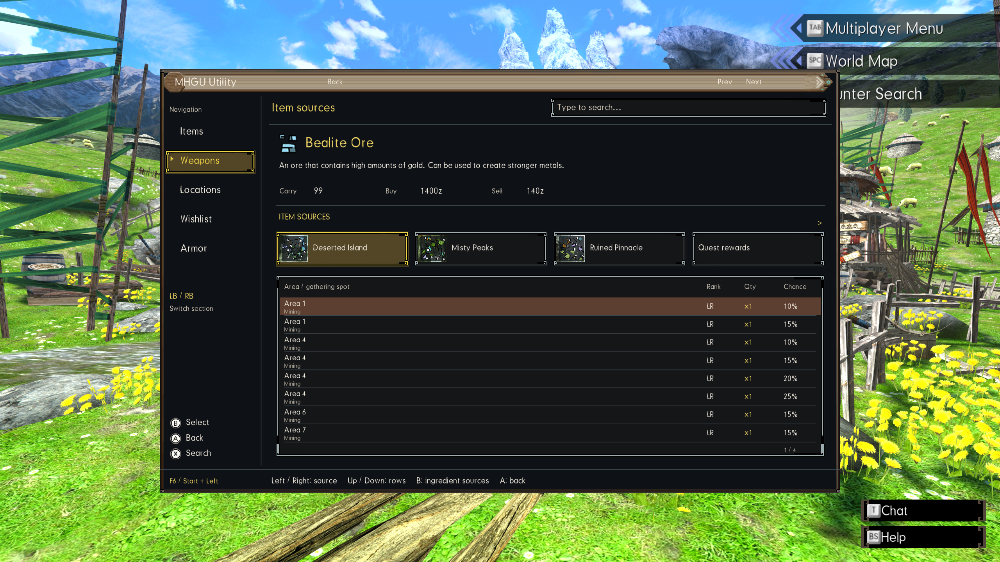 | 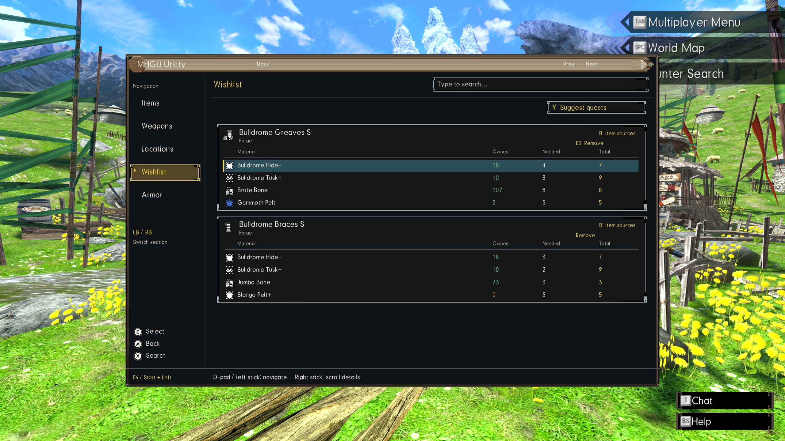 |

| Locations | Gathering by area |
| --- | --- |
| 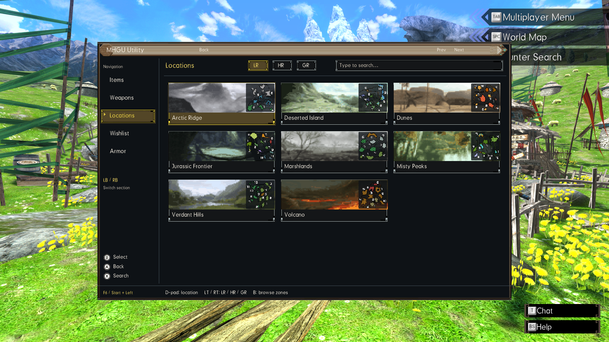 | 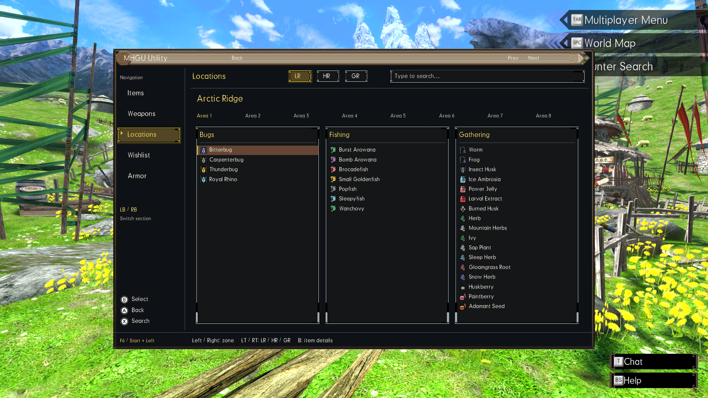 |

| Quest suggestions | Gathering checklist |
| --- | --- |
| 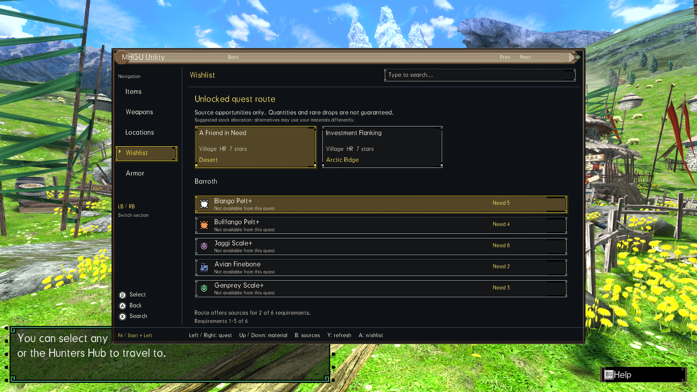 | 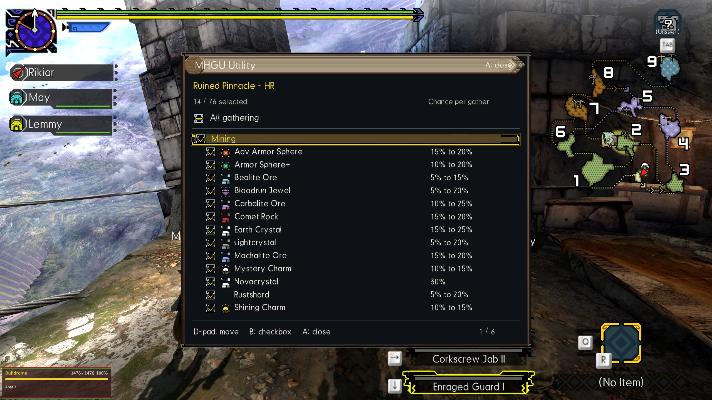 |

### Gathering markers alongside Map Assist

Grey and gold pickaxes mark selected mining points. The monster icon is drawn
by the separately installed Map Assist mod; the lower-left HP display is HuntLog.

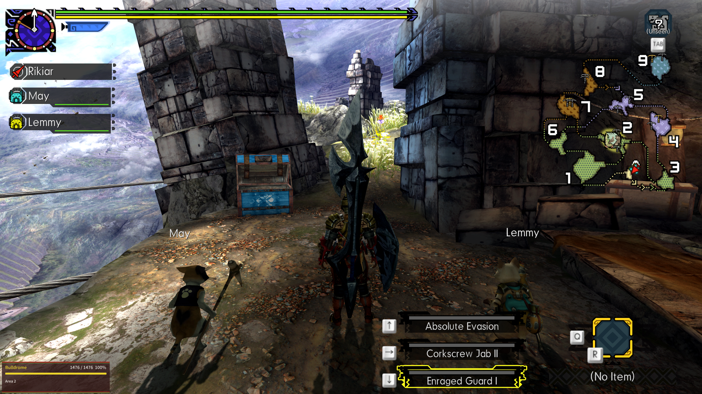

## Set Builder preview

This feature is on the [Set Builder branch](https://github.com/Rikiar73574/mhgu-utility/tree/feat/set-builder)
and is not included in the latest published release. The result shown here uses
verified equipment availability and a charm read from the copied character's box.

| Skill selection | Build results |
| --- | --- |
| 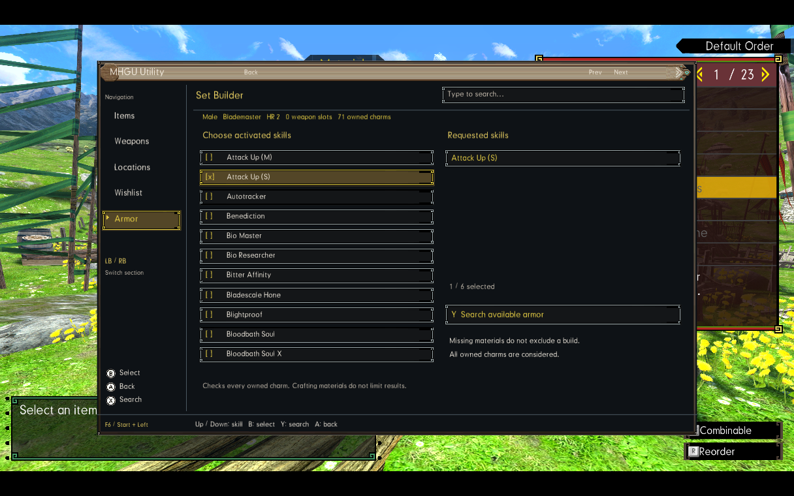 | 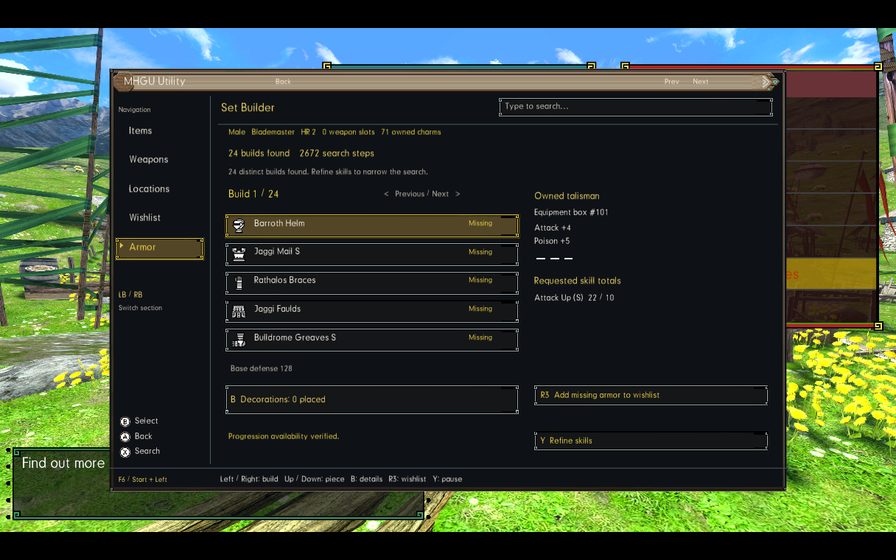 |

Earlier screenshots and validation records

### Earlier game captures

Captured on Linux with stock MHGURecomp and the complete installed mod stack,
using the standalone Compendium build identified in [validation](validation.md).
These are actual game captures, not the emulated preview renderer.

| Items | Weapon types | Weapon tree |
| --- | --- | --- |
|  |  |  |

| Weapon details | Material sources | Wishlist |
| --- | --- | --- |
|  |  |  |

| Controller search | Locations | Passive quest tracker |
| --- | --- | --- |
|  |  |  |

### Version 0.3.0

Captured in the separate hidden test game with copied save and HD textures/font.
See [UX validation](ux-validation.md) for artifact hashes and platform coverage.

| Item list | Controller search | Armor preview |
| --- | --- | --- |
|  |  |  |

| Keyboard editing (Windows executable under Wine) | Exact byproduct level | Point requirements without an eligible route |
| --- | --- | --- |
|  |  |  |

