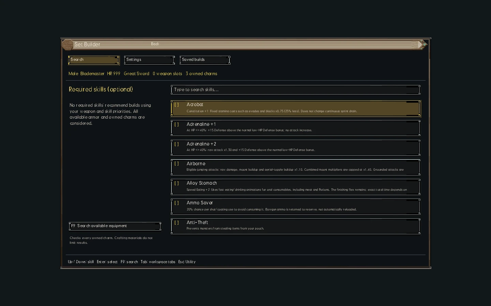
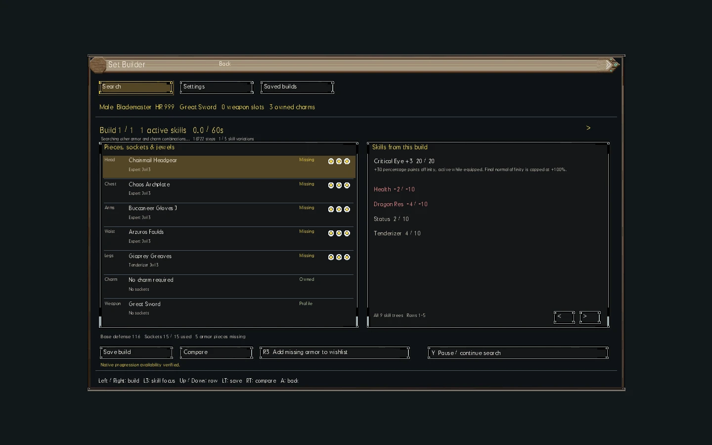
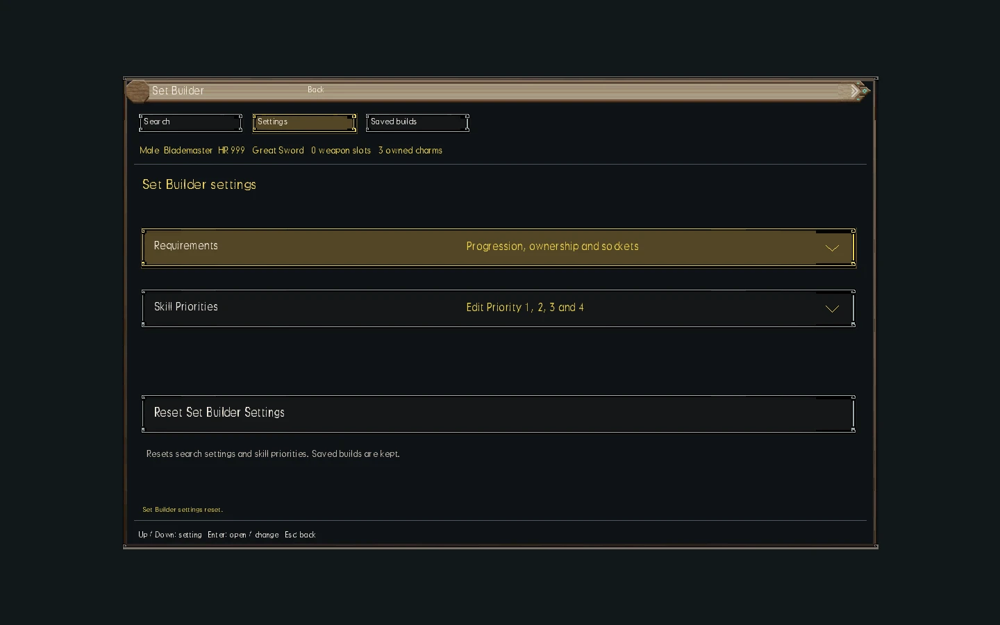
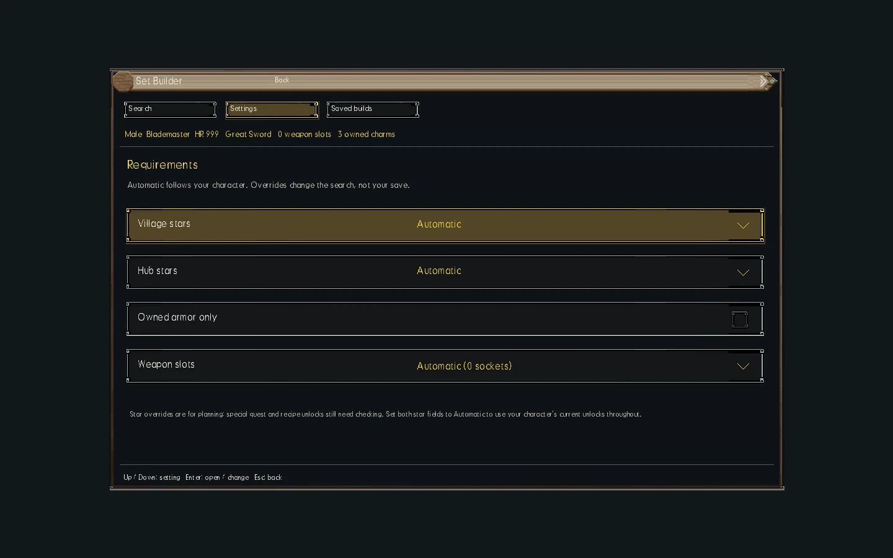
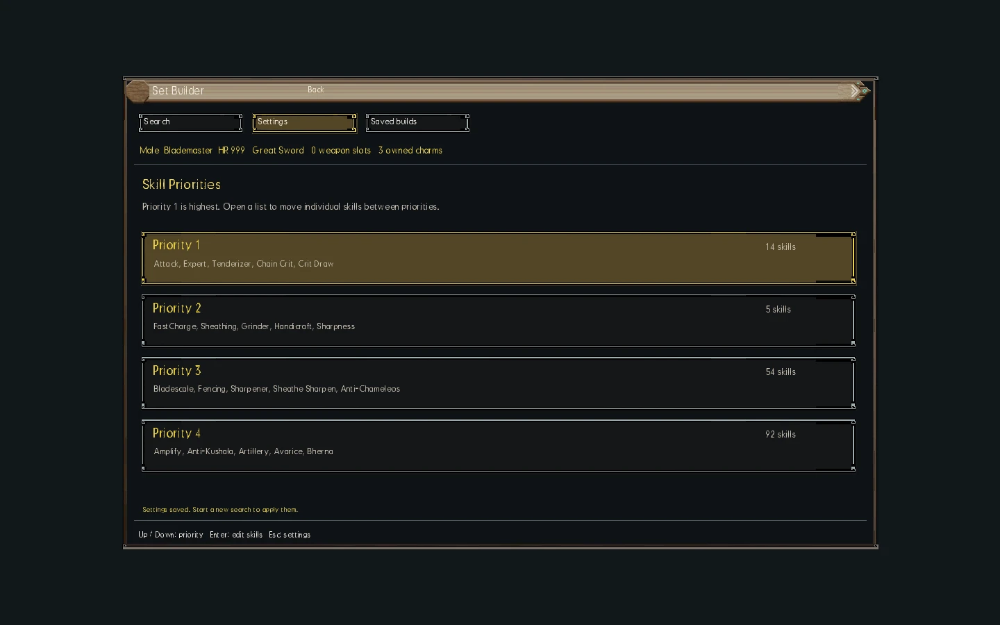

# Set Builder v0.5.0

Set Builder opens from its Utility section with B / Enter. LB / RB can pass through
the section without entering the workspace. Back returns through its pages to Utility.

Leave required skills empty for recommendations using the equipped weapon and
priority settings. Optional required skills remain minimum tiers. Searches use all
owned charms, native hunter/gender filters, available armor and per-container jewel
capacity; missing crafting stock does not exclude armor.

Settings contains Requirements, Skill Priorities and Reset. Village and Hub each
have an Automatic choice. An explicit star override is a planning scenario, not
proof of recipe or special-quest unlocks. The four numbered priority slots stay
fixed: move individual skills between them. Reset keeps named saved builds.

## Scheduling and results

Search uses the 19.2 MHz system tick to process up to eight existing work slices
within a cooperative 1 ms scheduling window. An indivisible slice can overrun the
window. A frozen/backwards clock cannot create an unbounded batch. Paused, hidden,
complete and unavailable searches do not keep consuming batches. The solver,
refiner, required-skill checks and ranking still validate each retained result.

The search pauses at 60 seconds or five distinct activated-skill combinations;
Continue / Y resumes. Results are best-found, not an exhaustive or globally optimal
set enumeration. Saved loadouts preserve their socket layout and require a fresh
search to revalidate current availability.

A deterministic host replay at 60 simulated frames per second found five Attack Up L
variations after 14.0 simulated seconds (first result
0.92s), and five unconstrained recommendations
after 3.1s. This uses a private captured character
and native-source solver adapters. It is not a live-game speed guarantee; interpreter
cost, machine load, progression and equipment affect scheduling.

## Verification

- Native release build, 122 Rust tests and 68 Python tests (66 passed, 2 skipped).
- Compiled ARM: optional skills, complete result view, settings/dropdown cancellation,
  independent Automatic choices, individual priority reassignment, reset retaining
  builds, save/rename/reopen, comparison, stored sockets and wishlist idempotency.
- Compiled ARM: system-tick execution, native input capture, mouse release, smithy
  hook chaining in both load orders, and native menu insertion.
- Deterministic scheduler tests cover deadlines, slice cap, frozen/backwards clocks,
  no-progress and terminal/hidden/unavailable states.
- Character/equipment fixture memory remains unchanged. Tests use private files.

The ARM harness mocks native quest/resource calls. These checks do not establish
new live quest-unlock, texture-replacement, multiplayer or whole-plugin-stack
compatibility. Prior compatibility records remain tied to their original builds.

NRO SHA-256: `d27ca19d45707437c55c26720b9e4253ae0fd90fd45bc990e2e568797fe157de`. Aligned image+BSS footprint: 9,502,720 bytes.
The individual budget is 9 MiB + 64 KiB; account for all plugins and loader alignment.

Preferences/loadouts use `utility_set_builder.txt` v2. Existing v1 records are read;
settings changes do not replace the character save or wishlist. Keep a backup of
this settings file with the NRO when rolling back to a build that only reads v1.

## Workspace screenshots

These images come from the compiled ARM renderer with isolated synthetic fixtures,
not a live hunt. Native quest/resource availability is mocked for the fixture.

| Optional required skills | Recommendations |
| --- | --- |
|  |  |

| Settings | Requirements |
| --- | --- |
|  |  |

